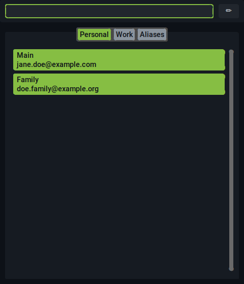
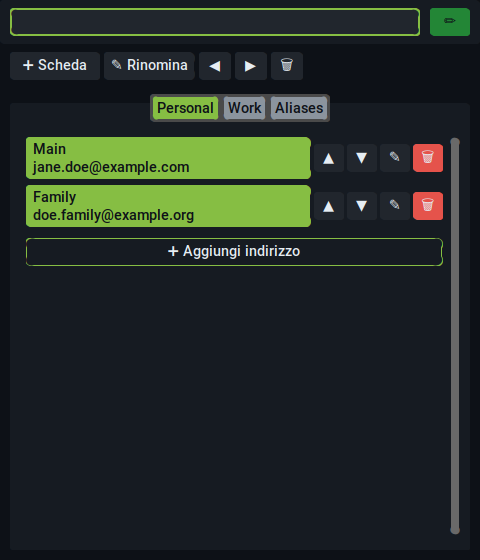

<a id="top"></a>

# ✉️ Email Picker


[](https://gitlab.com/FranzBias/email-picker)
[](https://www.paypal.com/donate/?hosted_button_id=HUF5MYDG465RY)

 

**[English](#english)** · **[Italiano](#italiano)** · **[Deutsch](#deutsch)** · **[Español](#espanol)** · **[Français](#francais)** · **[Nederlands](#nederlands)** · **[Русский](#russkij)** · **[العربية](#arabic)** · **[中文](#chinese)** · **[日本語](#japanese)**

---

<a id="english"></a>
## 🇬🇧 English

**Email Picker** keeps all your email addresses in tabs and copies one to the clipboard with a single click — from a tray icon or a global shortcut. Made for people with many addresses: personal, work, aliases, forwarding services.

### ✨ Features
- Addresses grouped in **tabs**, read from a simple `emails.json` file
- **Global search** across all tabs (name or address)
- One click → address in the clipboard, a desktop notification, window hides itself
- **Tray icon** (Show / Quit) and **global shortcut** `Ctrl+Shift+E` (configurable)
- **Edit mode** ✏️: add, edit, delete and reorder addresses and tabs right in the window — no need to touch the JSON file
- 4 themes: `dark`, `light`, `mint`, `system`
- Remembers window size and position
- Works with **[Lampo Mail](https://github.com/FranzBias/Lampo-Mail)**, which can read your addresses and add new ones

The interface is currently in Italian.

### 🛠️ Requirements
Linux with Python 3.10+ and Tk. Python packages: `customtkinter`, `pillow`, `pynput`, `plyer`, `pystray`.

### 🚀 Install
```bash
git clone https://github.com/FranzBias/email-picker.git
cd email-picker
./install.sh
python3 -m pip install --user -r requirements.txt   # add --break-system-packages on Debian 12+/Mint 22
```
`install.sh` needs no sudo: the app goes to `~/.local/share/email-picker`, your list to `~/.config/email-picker/emails.json` (created from the example, never overwritten), and «Email Picker» appears in the menu.

### 📝 Your addresses
Edit `~/.config/email-picker/emails.json`:
```json
{"tabs": [
  {"id": "work", "label": "Work", "order": 0,
   "entries": [{"name": "Office", "email": "j.doe@company.example"}]}
]}
```
`order` sets the tab order; `name` may be empty. Settings (theme, shortcut, search bar `top`/`bottom`) are in `config.json` in the same folder.

*Portable mode:* if an `emails.json` sits next to `email-picker.py`, that folder is used instead.

### 🗑️ Uninstall
`./uninstall.sh` removes the app and keeps your list; `./uninstall.sh --purge` removes the list too.

### 🙏 Credits
Built on [CustomTkinter](https://github.com/TomSchimansky/CustomTkinter) (MIT), [Pillow](https://python-pillow.org/) (MIT-CMU), [pynput](https://github.com/moses-palmer/pynput) and [pystray](https://github.com/moses-palmer/pystray) (LGPL-3.0, Moses Palmér), [plyer](https://github.com/kivy/plyer) (MIT, Kivy). The tray uses [Ayatana AppIndicator](https://github.com/AyatanaIndicators) through pystray, or its newer GLib version when installed. Dependencies are installed separately, not bundled.

### 📄 License
MIT — do what you like, just keep my name 😉 · Made with ❤️ by Franz Bias (Francesco) · [bybias.com](https://www.bybias.com)

[⬆ top](#top)

---

<a id="italiano"></a>
## 🇮🇹 Italiano

**Email Picker** tiene tutti i tuoi indirizzi email divisi in schede e ne copia uno negli appunti con un click — dall'icona nel vassoio o con una scorciatoia globale. Pensato per chi ha tanti indirizzi: personali, di lavoro, alias, servizi di inoltro.

### ✨ Funzioni
- Indirizzi divisi in **schede**, letti da un semplice file `emails.json`
- **Ricerca globale** su tutte le schede (nome o indirizzo)
- Un click → indirizzo negli appunti, notifica sul desktop, la finestra si nasconde
- **Icona nel vassoio** (Mostra / Esci) e **scorciatoia globale** `Ctrl+Maiusc+E` (modificabile)
- **Modalità modifica** ✏️: aggiungi, modifica, elimina e riordina indirizzi e schede direttamente nella finestra, senza toccare il file JSON
- 4 temi: `dark`, `light`, `mint`, `system`
- Ricorda dimensione e posizione della finestra
- Va d'accordo con **[Lampo Mail](https://github.com/FranzBias/Lampo-Mail)**, che legge i tuoi indirizzi e ne aggiunge di nuovi

### 🛠️ Requisiti
Linux con Python 3.10+ e Tk. Pacchetti Python: `customtkinter`, `pillow`, `pynput`, `plyer`, `pystray`.

### 🚀 Installazione
```bash
git clone https://github.com/FranzBias/email-picker.git
cd email-picker
./install.sh
python3 -m pip install --user -r requirements.txt   # su Debian 12+/Mint 22 aggiungi --break-system-packages
```
`install.sh` non chiede sudo: l'app va in `~/.local/share/email-picker`, la tua lista in `~/.config/email-picker/emails.json` (creata dall'esempio, mai sovrascritta), e «Email Picker» compare nel menu.

### 📝 I tuoi indirizzi
Modifica `~/.config/email-picker/emails.json` (formato nell'esempio inglese qui sopra): `order` decide l'ordine delle schede, `name` può restare vuoto. Le impostazioni (tema, scorciatoia, barra di ricerca `top`/`bottom`) stanno in `config.json`, nella stessa cartella.

*Modalità portatile:* se accanto a `email-picker.py` c'è un `emails.json`, si usa quella cartella.

### 🗑️ Disinstallazione
`./uninstall.sh` toglie l'app e lascia la tua lista; `./uninstall.sh --purge` toglie anche quella.

### 🙏 Crediti
Costruito su CustomTkinter (MIT), Pillow (MIT-CMU), pynput e pystray (LGPL-3.0, Moses Palmér), plyer (MIT, Kivy); il vassoio usa Ayatana AppIndicator tramite pystray, o la sua versione GLib più recente se installata. Link nella sezione inglese. Le dipendenze si installano a parte, non sono incluse.

### 📄 Licenza
MIT — fate quello che volete, basta che non togliate il mio nome 😉 · Realizzato con ❤️ da Franz Bias (Francesco) · [bybias.com](https://www.bybias.com)

[⬆ inizio](#top)

---

<a id="deutsch"></a>
## 🇩🇪 Deutsch

**Email Picker** hält alle deine E-Mail-Adressen in Reitern bereit und kopiert eine mit einem Klick in die Zwischenablage — über das Tray-Symbol oder ein globales Tastenkürzel. Für alle mit vielen Adressen: privat, beruflich, Aliase, Weiterleitungsdienste.

### ✨ Funktionen
- Adressen in **Reitern**, gelesen aus einer einfachen Datei `emails.json`
- **Globale Suche** über alle Reiter (Name oder Adresse)
- Ein Klick → Adresse in der Zwischenablage, Desktop-Benachrichtigung, das Fenster verschwindet
- **Tray-Symbol** (Anzeigen / Beenden) und **globales Kürzel** `Strg+Umschalt+E` (änderbar)
- **Bearbeitungsmodus** ✏️: Adressen und Reiter direkt im Fenster hinzufügen, bearbeiten, löschen und umsortieren – ohne die JSON-Datei anzufassen
- 4 Themes: `dark`, `light`, `mint`, `system`; Fenstergröße und -position werden gespeichert
- Arbeitet mit **[Lampo Mail](https://github.com/FranzBias/Lampo-Mail)** zusammen, das deine Adressen liest und neue hinzufügt

Die Oberfläche ist derzeit auf Italienisch.

### 🛠️ Voraussetzungen
Linux mit Python 3.10+ und Tk. Python-Pakete: `customtkinter`, `pillow`, `pynput`, `plyer`, `pystray`.

### 🚀 Installation
```bash
git clone https://github.com/FranzBias/email-picker.git
cd email-picker
./install.sh
python3 -m pip install --user -r requirements.txt   # unter Debian 12+/Mint 22 --break-system-packages ergänzen
```
`install.sh` braucht kein sudo: die App kommt nach `~/.local/share/email-picker`, deine Liste nach `~/.config/email-picker/emails.json` (aus dem Beispiel erstellt, nie überschrieben), und «Email Picker» erscheint im Menü.

### 📝 Deine Adressen
Bearbeite `~/.config/email-picker/emails.json` (Format im englischen Beispiel oben): `order` bestimmt die Reihenfolge der Reiter, `name` darf leer bleiben. Einstellungen (Theme, Kürzel, Suchleiste `top`/`bottom`) stehen in `config.json` im selben Ordner. *Portabel:* liegt eine `emails.json` neben `email-picker.py`, wird dieser Ordner verwendet.

### 🗑️ Deinstallation
`./uninstall.sh` entfernt die App und behält deine Liste; `./uninstall.sh --purge` entfernt auch die Liste.

### 🙏 Danksagung
Gebaut auf CustomTkinter (MIT), Pillow (MIT-CMU), pynput und pystray (LGPL-3.0, Moses Palmér), plyer (MIT, Kivy); das Tray nutzt Ayatana AppIndicator. Links im englischen Abschnitt. Abhängigkeiten werden separat installiert, nicht mitgeliefert.

### 📄 Lizenz
MIT — mach damit, was du willst, nur meinen Namen bitte drinlassen 😉 · Mit ❤️ gemacht von Franz Bias (Francesco) · [bybias.com](https://www.bybias.com)

[⬆ nach oben](#top)

---

<a id="espanol"></a>
## 🇪🇸 Español

**Email Picker** guarda todas tus direcciones de correo en pestañas y copia una al portapapeles con un clic — desde el icono de la bandeja o con un atajo global. Pensado para quien tiene muchas direcciones: personales, de trabajo, alias, servicios de reenvío.

### ✨ Funciones
- Direcciones en **pestañas**, leídas de un sencillo archivo `emails.json`
- **Búsqueda global** en todas las pestañas (nombre o dirección)
- Un clic → dirección en el portapapeles, notificación de escritorio, la ventana se oculta
- **Icono en la bandeja** (Mostrar / Salir) y **atajo global** `Ctrl+Mayús+E` (configurable)
- **Modo edición** ✏️: añade, edita, borra y reordena direcciones y pestañas en la propia ventana, sin tocar el archivo JSON
- 4 temas: `dark`, `light`, `mint`, `system`; recuerda tamaño y posición de la ventana
- Se entiende con **[Lampo Mail](https://github.com/FranzBias/Lampo-Mail)**, que lee tus direcciones y añade otras nuevas

Por ahora la interfaz está en italiano.

### 🛠️ Requisitos
Linux con Python 3.10+ y Tk. Paquetes de Python: `customtkinter`, `pillow`, `pynput`, `plyer`, `pystray`.

### 🚀 Instalación
```bash
git clone https://github.com/FranzBias/email-picker.git
cd email-picker
./install.sh
python3 -m pip install --user -r requirements.txt   # en Debian 12+/Mint 22 añade --break-system-packages
```
`install.sh` no necesita sudo: la aplicación va a `~/.local/share/email-picker`, tu lista a `~/.config/email-picker/emails.json` (creada a partir del ejemplo, nunca sobrescrita), y «Email Picker» aparece en el menú.

### 📝 Tus direcciones
Edita `~/.config/email-picker/emails.json` (formato en el ejemplo inglés de arriba): `order` fija el orden de las pestañas, `name` puede quedar vacío. Los ajustes (tema, atajo, barra de búsqueda `top`/`bottom`) están en `config.json`, en la misma carpeta. *Modo portátil:* si hay un `emails.json` junto a `email-picker.py`, se usa esa carpeta.

### 🗑️ Desinstalación
`./uninstall.sh` quita la aplicación y conserva tu lista; `./uninstall.sh --purge` también quita la lista.

### 🙏 Créditos
Hecho con CustomTkinter (MIT), Pillow (MIT-CMU), pynput y pystray (LGPL-3.0, Moses Palmér), plyer (MIT, Kivy); la bandeja usa Ayatana AppIndicator. Enlaces en la sección inglesa. Las dependencias se instalan aparte, no van incluidas.

### 📄 Licencia
MIT — haz lo que quieras, solo no quites mi nombre 😉 · Hecho con ❤️ por Franz Bias (Francesco) · [bybias.com](https://www.bybias.com)

[⬆ arriba](#top)

---

<a id="francais"></a>
## 🇫🇷 Français

**Email Picker** range toutes tes adresses e-mail dans des onglets et en copie une dans le presse-papiers d'un clic — depuis l'icône de la zone de notification ou avec un raccourci global. Pour celles et ceux qui ont beaucoup d'adresses : perso, travail, alias, services de redirection.

### ✨ Fonctions
- Adresses en **onglets**, lues depuis un simple fichier `emails.json`
- **Recherche globale** dans tous les onglets (nom ou adresse)
- Un clic → adresse dans le presse-papiers, notification de bureau, la fenêtre se cache
- **Icône de notification** (Afficher / Quitter) et **raccourci global** `Ctrl+Maj+E` (modifiable)
- **Mode édition** ✏️ : ajoute, modifie, supprime et réordonne adresses et onglets directement dans la fenêtre, sans toucher au fichier JSON
- 4 thèmes : `dark`, `light`, `mint`, `system` ; mémorise taille et position de la fenêtre
- S'entend avec **[Lampo Mail](https://github.com/FranzBias/Lampo-Mail)**, qui lit tes adresses et en ajoute de nouvelles

L'interface est pour l'instant en italien.

### 🛠️ Prérequis
Linux avec Python 3.10+ et Tk. Paquets Python : `customtkinter`, `pillow`, `pynput`, `plyer`, `pystray`.

### 🚀 Installation
```bash
git clone https://github.com/FranzBias/email-picker.git
cd email-picker
./install.sh
python3 -m pip install --user -r requirements.txt   # sous Debian 12+/Mint 22 ajoute --break-system-packages
```
`install.sh` n'a pas besoin de sudo : l'application va dans `~/.local/share/email-picker`, ta liste dans `~/.config/email-picker/emails.json` (créée à partir de l'exemple, jamais écrasée), et « Email Picker » apparaît dans le menu.

### 📝 Tes adresses
Modifie `~/.config/email-picker/emails.json` (format dans l'exemple anglais ci-dessus) : `order` fixe l'ordre des onglets, `name` peut rester vide. Les réglages (thème, raccourci, barre de recherche `top`/`bottom`) sont dans `config.json`, dans le même dossier. *Mode portable :* s'il y a un `emails.json` à côté de `email-picker.py`, c'est ce dossier qui est utilisé.

### 🗑️ Désinstallation
`./uninstall.sh` enlève l'application et garde ta liste ; `./uninstall.sh --purge` enlève aussi la liste.

### 🙏 Remerciements
Construit sur CustomTkinter (MIT), Pillow (MIT-CMU), pynput et pystray (LGPL-3.0, Moses Palmér), plyer (MIT, Kivy) ; la zone de notification utilise Ayatana AppIndicator. Liens dans la section anglaise. Les dépendances s'installent à part, elles ne sont pas incluses.

### 📄 Licence
MIT — fais-en ce que tu veux, garde juste mon nom 😉 · Fait avec ❤️ par Franz Bias (Francesco) · [bybias.com](https://www.bybias.com)

[⬆ haut](#top)

---

<a id="nederlands"></a>
## 🇳🇱 Nederlands

**Email Picker** bewaart al je e-mailadressen in tabbladen en kopieert er één met een klik naar het klembord — via het pictogram in het systeemvak of een globale sneltoets. Voor wie veel adressen heeft: privé, werk, aliassen, doorstuurdiensten.

### ✨ Functies
- Adressen in **tabbladen**, gelezen uit een eenvoudig bestand `emails.json`
- **Globaal zoeken** in alle tabbladen (naam of adres)
- Eén klik → adres op het klembord, een bureaubladmelding, het venster verdwijnt
- **Pictogram in het systeemvak** (Tonen / Afsluiten) en **globale sneltoets** `Ctrl+Shift+E` (instelbaar)
- **Bewerkmodus** ✏️: adressen en tabbladen toevoegen, bewerken, verwijderen en herschikken in het venster zelf, zonder het JSON-bestand aan te raken
- 4 thema's: `dark`, `light`, `mint`, `system`; onthoudt grootte en positie van het venster
- Werkt samen met **[Lampo Mail](https://github.com/FranzBias/Lampo-Mail)**, dat je adressen leest en nieuwe toevoegt

De interface is voorlopig in het Italiaans.

### 🛠️ Vereisten
Linux met Python 3.10+ en Tk. Python-pakketten: `customtkinter`, `pillow`, `pynput`, `plyer`, `pystray`.

### 🚀 Installatie
```bash
git clone https://github.com/FranzBias/email-picker.git
cd email-picker
./install.sh
python3 -m pip install --user -r requirements.txt   # op Debian 12+/Mint 22 voeg --break-system-packages toe
```
`install.sh` heeft geen sudo nodig: de app komt in `~/.local/share/email-picker`, je lijst in `~/.config/email-picker/emails.json` (gemaakt uit het voorbeeld, nooit overschreven), en «Email Picker» verschijnt in het menu.

### 📝 Je adressen
Bewerk `~/.config/email-picker/emails.json` (formaat in het Engelse voorbeeld hierboven): `order` bepaalt de volgorde van de tabbladen, `name` mag leeg blijven. Instellingen (thema, sneltoets, zoekbalk `top`/`bottom`) staan in `config.json` in dezelfde map. *Draagbaar:* staat er een `emails.json` naast `email-picker.py`, dan wordt die map gebruikt.

### 🗑️ Verwijderen
`./uninstall.sh` verwijdert de app en houdt je lijst; `./uninstall.sh --purge` verwijdert ook de lijst.

### 🙏 Met dank aan
Gebouwd op CustomTkinter (MIT), Pillow (MIT-CMU), pynput en pystray (LGPL-3.0, Moses Palmér), plyer (MIT, Kivy); het systeemvak gebruikt Ayatana AppIndicator. Links in de Engelse sectie. Afhankelijkheden worden apart geïnstalleerd, niet meegeleverd.

### 📄 Licentie
MIT — doe ermee wat je wilt, laat alleen mijn naam staan 😉 · Gemaakt met ❤️ door Franz Bias (Francesco) · [bybias.com](https://www.bybias.com)

[⬆ boven](#top)

---

<a id="russkij"></a>
## 🇷🇺 Русский

**Email Picker** хранит все ваши адреса электронной почты во вкладках и копирует нужный в буфер обмена одним щелчком — из значка в трее или по глобальному сочетанию клавиш. Для тех, у кого много адресов: личные, рабочие, псевдонимы, сервисы пересылки.

### ✨ Возможности
- Адреса во **вкладках**, из простого файла `emails.json`
- **Глобальный поиск** по всем вкладкам (имя или адрес)
- Один щелчок → адрес в буфере обмена, уведомление на рабочем столе, окно скрывается
- **Значок в трее** (Показать / Выход) и **глобальное сочетание** `Ctrl+Shift+E` (настраивается)
- **Режим правки** ✏️: добавляйте, изменяйте, удаляйте и переставляйте адреса и вкладки прямо в окне, не трогая файл JSON
- 4 темы: `dark`, `light`, `mint`, `system`; запоминает размер и положение окна
- Работает вместе с **[Lampo Mail](https://github.com/FranzBias/Lampo-Mail)**, который читает ваши адреса и добавляет новые

Интерфейс пока на итальянском языке.

### 🛠️ Требования
Linux с Python 3.10+ и Tk. Пакеты Python: `customtkinter`, `pillow`, `pynput`, `plyer`, `pystray`.

### 🚀 Установка
```bash
git clone https://github.com/FranzBias/email-picker.git
cd email-picker
./install.sh
python3 -m pip install --user -r requirements.txt   # в Debian 12+/Mint 22 добавьте --break-system-packages
```
`install.sh` не требует sudo: приложение — в `~/.local/share/email-picker`, ваш список — в `~/.config/email-picker/emails.json` (создаётся из примера и никогда не перезаписывается), а «Email Picker» появляется в меню.

### 📝 Ваши адреса
Отредактируйте `~/.config/email-picker/emails.json` (формат — в английском примере выше): `order` задаёт порядок вкладок, `name` может быть пустым. Настройки (тема, сочетание клавиш, строка поиска `top`/`bottom`) — в `config.json` в той же папке. *Переносной режим:* если рядом с `email-picker.py` лежит `emails.json`, используется эта папка.

### 🗑️ Удаление
`./uninstall.sh` удаляет приложение и сохраняет список; `./uninstall.sh --purge` удаляет и список.

### 🙏 Благодарности
Создано на основе CustomTkinter (MIT), Pillow (MIT-CMU), pynput и pystray (LGPL-3.0, Moses Palmér), plyer (MIT, Kivy); трей использует Ayatana AppIndicator. Ссылки — в английском разделе. Зависимости устанавливаются отдельно и не входят в комплект.

### 📄 Лицензия
MIT — делайте что хотите, только оставьте моё имя 😉 · Сделано с ❤️ Franz Bias (Francesco) · [bybias.com](https://www.bybias.com)

[⬆ наверх](#top)

---

<a id="arabic"></a>
## 🇸🇦 العربية

<div dir="rtl">

**Email Picker** يحفظ جميع عناوين بريدك الإلكتروني في ألسنة تبويب، وينسخ أيًّا منها إلى الحافظة بنقرة واحدة — من أيقونة شريط النظام أو باختصار لوحة مفاتيح عام. مناسب لمن لديه عناوين كثيرة: شخصية، للعمل، أسماء مستعارة، خدمات إعادة التوجيه.

### ✨ الميزات
- العناوين مقسَّمة في **ألسنة تبويب**، تُقرأ من ملف بسيط `emails.json`
- **بحث شامل** في كل الألسنة (الاسم أو العنوان)
- نقرة واحدة ← العنوان في الحافظة، إشعار على سطح المكتب، وتختفي النافذة
- **أيقونة في شريط النظام** (إظهار / خروج) و**اختصار عام** `Ctrl+Shift+E` (قابل للتغيير)
- **وضع التحرير** ✏️: أضف العناوين والألسنة وعدّلها واحذفها وأعد ترتيبها من النافذة نفسها، دون لمس ملف JSON
- 4 سمات: `dark`، `light`، `mint`، `system`؛ ويتذكر حجم النافذة وموضعها
- يعمل مع **[Lampo Mail](https://github.com/FranzBias/Lampo-Mail)** الذي يقرأ عناوينك ويضيف عناوين جديدة

الواجهة حاليًا باللغة الإيطالية.

### 🛠️ المتطلبات
لينكس مع Python 3.10 أو أحدث و Tk. حزم Python: `customtkinter`، `pillow`، `pynput`، `plyer`، `pystray`.

### 🚀 التثبيت

</div>

```bash
git clone https://github.com/FranzBias/email-picker.git
cd email-picker
./install.sh
python3 -m pip install --user -r requirements.txt   # Debian 12+/Mint 22: --break-system-packages
```

<div dir="rtl">

لا يحتاج `install.sh` إلى sudo: يوضع التطبيق في `~/.local/share/email-picker`، وقائمتك في `~/.config/email-picker/emails.json` (تُنشأ من المثال ولا يُكتب فوقها أبدًا)، ويظهر «Email Picker» في القائمة.

### 📝 عناوينك
عدّل الملف `~/.config/email-picker/emails.json` (الصيغة في المثال الإنجليزي أعلاه): `order` يحدد ترتيب الألسنة، ويمكن ترك `name` فارغًا. الإعدادات (السمة، الاختصار، موضع شريط البحث `top`/`bottom`) في `config.json` في المجلد نفسه. *الوضع المحمول:* إن وُجد `emails.json` بجانب `email-picker.py` فسيُستخدم ذلك المجلد.

### 🗑️ إلغاء التثبيت
`./uninstall.sh` يزيل التطبيق ويُبقي قائمتك؛ و`./uninstall.sh --purge` يزيل القائمة أيضًا.

### 🙏 شكر وتقدير
مبني على CustomTkinter (MIT)، Pillow (MIT-CMU)، pynput و pystray (LGPL-3.0، Moses Palmér)، plyer (MIT، Kivy)؛ وتستخدم أيقونة الشريط Ayatana AppIndicator. الروابط في القسم الإنجليزي. تُثبَّت الاعتماديات بشكل منفصل ولا تُرفق.

### 📄 الترخيص
MIT — افعل ما تشاء، فقط أبقِ اسمي 😉 · صُنع بـ ❤️ بواسطة Franz Bias (Francesco) · [bybias.com](https://www.bybias.com)

</div>

[⬆ للأعلى](#top)

---

<a id="chinese"></a>
## 🇨🇳 中文

**Email Picker** 把你所有的电子邮件地址分门别类放在标签页里，单击即可复制到剪贴板——通过托盘图标或全局快捷键。适合拥有很多地址的人：个人、工作、别名、转发服务。

### ✨ 功能
- 地址按**标签页**分组，读取自简单的 `emails.json` 文件
- 在所有标签页中**全局搜索**（名称或地址）
- 单击 → 地址进入剪贴板，弹出桌面通知，窗口自动隐藏
- **托盘图标**（显示 / 退出）和**全局快捷键** `Ctrl+Shift+E`（可配置）
- **编辑模式** ✏️：直接在窗口中添加、编辑、删除和重新排序地址与标签页，无需手动修改 JSON 文件
- 4 种主题：`dark`、`light`、`mint`、`system`；记住窗口大小和位置
- 与 **[Lampo Mail](https://github.com/FranzBias/Lampo-Mail)** 配合使用，它可以读取你的地址并添加新地址

界面目前为意大利语。

### 🛠️ 要求
Linux，Python 3.10+ 和 Tk。Python 包：`customtkinter`、`pillow`、`pynput`、`plyer`、`pystray`。

### 🚀 安装
```bash
git clone https://github.com/FranzBias/email-picker.git
cd email-picker
./install.sh
python3 -m pip install --user -r requirements.txt   # 在 Debian 12+/Mint 22 上加 --break-system-packages
```
`install.sh` 无需 sudo：应用安装到 `~/.local/share/email-picker`，你的列表在 `~/.config/email-picker/emails.json`（由示例生成，绝不会被覆盖），菜单中会出现「Email Picker」。

### 📝 你的地址
编辑 `~/.config/email-picker/emails.json`（格式见上方英文示例）：`order` 决定标签页顺序，`name` 可以留空。设置（主题、快捷键、搜索栏 `top`/`bottom`）在同一文件夹的 `config.json` 中。*便携模式：*如果 `email-picker.py` 旁边有 `emails.json`，就使用该文件夹。

### 🗑️ 卸载
`./uninstall.sh` 删除应用并保留你的列表；`./uninstall.sh --purge` 连列表一起删除。

### 🙏 致谢
基于 CustomTkinter（MIT）、Pillow（MIT-CMU）、pynput 和 pystray（LGPL-3.0，Moses Palmér）、plyer（MIT，Kivy）构建；托盘使用 Ayatana AppIndicator。链接见英文部分。依赖需单独安装，不随附。

### 📄 许可证
MIT——随意使用，只需保留我的名字 😉 · 由 Franz Bias（Francesco）用 ❤️ 制作 · [bybias.com](https://www.bybias.com)

[⬆ 返回顶部](#top)

---

<a id="japanese"></a>
## 🇯🇵 日本語

**Email Picker** はあなたのメールアドレスをすべてタブに整理し、ワンクリックでクリップボードにコピーします——トレイアイコンからでも、グローバルショートカットからでも。個人用、仕事用、エイリアス、転送サービスなど、たくさんのアドレスを持つ人のためのツールです。

### ✨ 機能
- アドレスを**タブ**で整理、シンプルな `emails.json` ファイルから読み込み
- すべてのタブを対象にした**全体検索**（名前またはアドレス）
- ワンクリック → アドレスがクリップボードへ、デスクトップ通知、ウィンドウは自動で隠れる
- **トレイアイコン**（表示 / 終了）と**グローバルショートカット** `Ctrl+Shift+E`（変更可能）
- **編集モード** ✏️：JSON ファイルを触らずに、ウィンドウ上でアドレスやタブの追加・編集・削除・並べ替えができます
- 4 つのテーマ：`dark`、`light`、`mint`、`system`。ウィンドウのサイズと位置を記憶
- **[Lampo Mail](https://github.com/FranzBias/Lampo-Mail)** と連携し、アドレスの読み込みや新規追加が可能

インターフェースは現在イタリア語です。

### 🛠️ 必要なもの
Linux、Python 3.10 以上と Tk。Python パッケージ：`customtkinter`、`pillow`、`pynput`、`plyer`、`pystray`。

### 🚀 インストール
```bash
git clone https://github.com/FranzBias/email-picker.git
cd email-picker
./install.sh
python3 -m pip install --user -r requirements.txt   # Debian 12+/Mint 22 では --break-system-packages を追加
```
`install.sh` は sudo 不要です。アプリは `~/.local/share/email-picker` に、リストは `~/.config/email-picker/emails.json` に置かれ（サンプルから作成、上書きされることはありません）、メニューに「Email Picker」が表示されます。

### 📝 あなたのアドレス
`~/.config/email-picker/emails.json` を編集します（形式は上の英語の例を参照）。`order` でタブの順番を決め、`name` は空でも構いません。設定（テーマ、ショートカット、検索バー `top`/`bottom`）は同じフォルダの `config.json` にあります。*ポータブルモード：*`email-picker.py` の隣に `emails.json` があれば、そのフォルダが使われます。

### 🗑️ アンインストール
`./uninstall.sh` はアプリを削除し、リストは残します。`./uninstall.sh --purge` ならリストも削除します。

### 🙏 クレジット
CustomTkinter（MIT）、Pillow（MIT-CMU）、pynput と pystray（LGPL-3.0、Moses Palmér）、plyer（MIT、Kivy）を使用しています。トレイには Ayatana AppIndicator を使用。リンクは英語セクションにあります。依存パッケージは別途インストールが必要で、同梱されていません。

### 📄 ライセンス
MIT —— 自由に使ってください、名前だけは残してね 😉 · Franz Bias（Francesco）が ❤️ を込めて作りました · [bybias.com](https://www.bybias.com)

[⬆ トップへ](#top)
